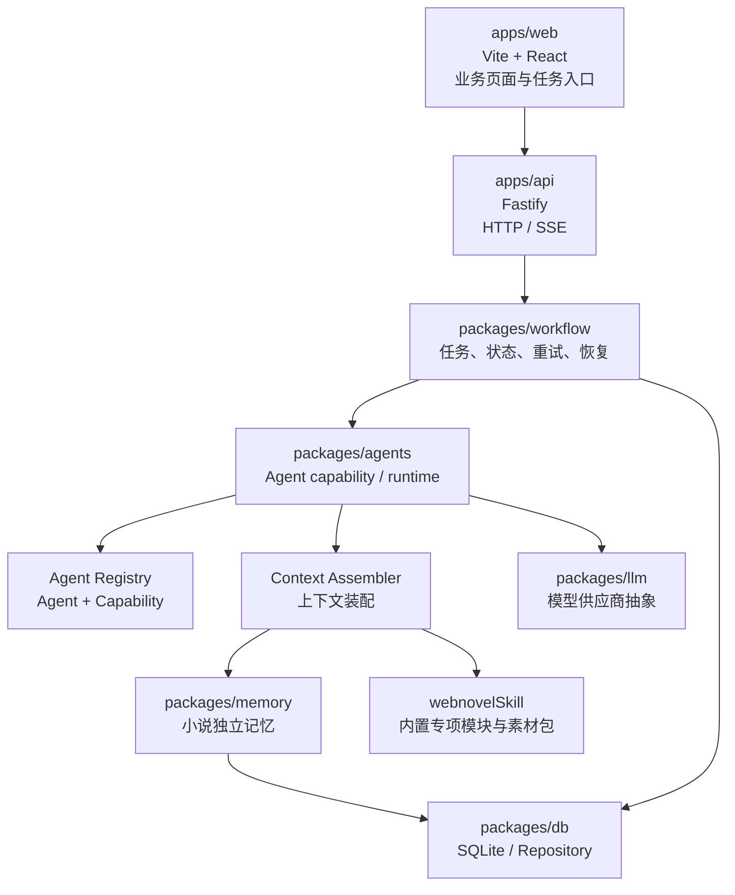

# 系统架构总览

## 1. 架构定位

本项目是本地优先的中文网文创作 Agent 管理平台。系统核心不是聊天窗口，也不是 Prompt 配置平台，而是围绕小说资产、任务工作流、Agent 能力、独立记忆和质量闭环构建的生产系统。

后续 AI 或开发者接手本项目时，必须先理解以下边界：

1. 前端只展示业务能力和任务入口，不展示 Agent、Prompt、Skill 或 Workflow 内部步骤配置。
2. API 只负责请求校验、任务创建、服务组合和进度推送，不直接拼接复杂 Prompt。
3. Workflow 层通过项目自有 TypeScript 编排串联 Agent capability，不使用 LangGraph.js，也不绕过 Agent 写业务逻辑。
4. 记忆、检索、章节、角色、伏笔、评审和任务都必须绑定 `novelId`。
5. 本地文件和数据库负责沉淀全部资产，RAG 只是检索层，不是权威存储层。

## 2. 总体分层



MVP 可以先用内存任务与本地 mock 资产跑通闭环，但结构上仍要按上图演进，避免把临时代码固化成页面直连模型。

## 3. 前端调用原则

前端页面不理解“调用哪个 Agent”。页面只触发业务任务。

示例：

```txt
大纲页点击“生成第一卷规划”
-> POST /api/novels/:novelId/outlines/generate-first
-> API 创建或执行 outline-planning 任务
-> Agent 层完成大纲生成、结构审查和章纲草案输出
-> 前端展示任务结果和待确认草案
```

页面允许展示：

- 任务名称。
- 输入摘要。
- 当前状态。
- 输出草案。
- 评审结果。
- 重试入口。

页面不允许展示：

- Prompt 正文。
- Skill 模块配置。
- 工具权限配置。
- Workflow 内部步骤编辑器。
- Agent 角色配置。

## 4. API 与任务边界

API 层负责：

1. 校验 `novelId` 和请求输入。
2. 创建 `WorkflowTask`。
3. 调用 workflow runner。
4. 通过 SSE 推送任务进度。
5. 返回任务结果或任务 ID。

推荐 API 形态：

```txt
GET  /api/health
POST /api/novels/:novelId/outlines/generate-first
GET  /api/novels/:novelId/tasks
GET  /api/tasks/:taskId/events
```

后续统一任务入口可以扩展为：

```txt
POST /api/novels/:novelId/tasks
{
  "workflowName": "outline-planning",
  "intent": "generateFirstOutline",
  "input": {}
}
```

## 5. Agent 与 capability

顶层 Agent 只保留稳定职责域：

| Agent | 职责 |
| --- | --- |
| `director` | 选择工作流、规划下一步、处理人工确认点 |
| `inspiration` | 灵感、卖点、标题和简介候选 |
| `outline` | 总纲、卷纲、章纲生成与修改 |
| `prose` | 正文生成、修改、扩写、压缩、重写和风格处理 |
| `review` | 大纲评审、章节评审、一致性评审和风格评审 |
| `memory` | 上下文检索、canon 提取和小说记忆更新 |
| `analytics` | 后续阅读数据导入、分析和调整建议 |

不要新增顶层“生成 Agent”或“修改 Agent”。正文生成和修改统一归入 `prose`。大纲生成、卷纲生成、章纲生成和大纲修改统一归入 `outline`。

## 6. 中文网文专项路由

`packages/agents/src/webnovelSkill/` 是中文网文专项能力层。它不是用户可配置 Skill，而是系统内置能力。

专项模块包括：

- 前置规划。
- 开头。
- 分卷章纲。
- 剧情逻辑。
- 人物一致性。
- 转场。
- 对白。
- 章末。
- 去 AI 味。
- 完稿审查。

调用原则：

```txt
业务任务
-> Agent capability
-> routeWebnovelTask
-> 选择 primaryModule 和 supportModules
-> buildWebnovelPromptContext
-> 上下文装配
-> LLM
-> 结构化输出
```

例如章节生成默认链路：

```txt
plot_logic
-> character_consistency
-> transition
-> dialogue
-> chapter_ending
-> anti_ai_voice
-> consistency_review
```

这些模块不应被做成前端可配置项。

## 7. 记忆、RAG 与本地资产

本项目不应该在“全部文件沉淀”和“RAG”之间二选一。推荐结论是：

```txt
本地资产沉淀为主
SQLite 结构化状态为核心
本地文件保存长文本和版本快照
SQLite FTS / BM25 做基础检索
向量 RAG 做语义增强
Context Assembler 决定每次给模型什么
```

权威资产层必须本地保存：

- 小说基础盘。
- 立项定位。
- 世界观。
- 角色状态。
- 总纲、卷纲、章纲。
- 章节正文版本。
- 伏笔账本。
- 时间线事件。
- 评审报告。
- Agent 运行记录。
- Workflow task。

RAG 只负责按任务召回相关片段，不负责判断权威事实。canon 事实、角色当前状态、伏笔状态和章节顺序必须走结构化资产。

## 8. 上下文装配策略

上下文装配层建议命名为 `ContextAssembler`。它的输入是任务范围和 token 预算：

```ts
{
  novelId: string;
  taskKind: "outline" | "chapter_draft" | "chapter_review" | "local_revision";
  scope: "novel" | "volume" | "chapter" | "scene";
  volumeId?: string;
  chapterId?: string;
  tokenBudget: number;
}
```

输出是给 Agent capability 使用的上下文包：

```ts
{
  structuredAssets: unknown;
  canonFacts: string[];
  workingSummaries: string[];
  ragSnippets: string[];
  styleConstraints: string[];
  webnovelModules: unknown;
  externalSourceCards: unknown[];
  compressionReport: string;
}
```

装配优先级：

1. 必读结构化资产：当前章纲、当前卷目标、角色当前状态、世界观硬规则、伏笔账本。
2. 近邻窗口：最近 3 到 5 章摘要、前后 10 到 20 章章纲、上一章结尾、下一章目标。
3. 长程检索：早期伏笔、历史关系、跨卷因果、旧设定。
4. 外部资料：只有确认授权后才能导入本地私有语料库；未授权长文本只能作为来源索引记录。

## 9. 大纲首次生成闭环

当前已落地的最小闭环是：

```txt
apps/web 大纲页
-> POST /api/novels/:novelId/outlines/generate-first
-> apps/api Fastify
-> packages/agents runtime
-> outline-planning 自有 Workflow
-> webnovelSkill 路由 outline
-> packages/llm 真实模型调用
-> 返回总纲、第一卷规划、前 10 章章纲、时间线、伏笔和结构问题
-> 前端刷新大纲驾驶舱
```

这条链路目前用于验证真实模型调用和前后端闭环。后续较长时间的重心转向 Agent 底层能力：先让 Workflow、章节资产、AgentRun 和小说记忆在包内独立跑稳，再单独规划 Web/API 接入。

## 10. 后续实现顺序

1. 完成章节草稿、评审报告、修订历史、质量门禁和 AgentRun 的持久化。
2. 增加人工确认点：未确认草稿不得写入 canon。
3. 建立最小小说记忆更新：章节摘要、canon facts、角色状态变化和伏笔状态变化。
4. 增强 `ContextAssembler` / repository 的结构化读取、FTS 检索和 token 压缩。
5. 让下一章生产读取上一章摘要、已确认事实、近邻章纲和伏笔账本。
6. 包内验证稳定后，再规划 Web/API 接入、SSE 事件流和任务中心展示。
