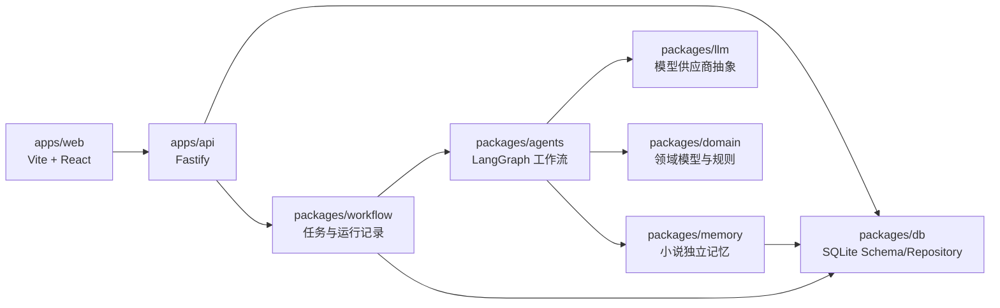
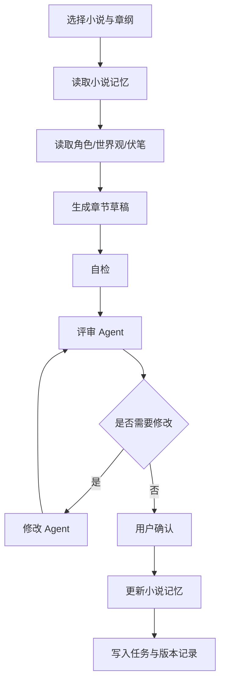

# 技术设计文档

## 1. 技术栈

- 前端：Vite + React + TypeScript。
- 后端：Fastify + TypeScript。
- Agent 编排：LangGraph.js。
- 包管理：pnpm workspace。
- 数据库：SQLite 起步，后续保留 PostgreSQL 迁移空间。
- 实时进度：MVP 优先 SSE，后续按需要升级 WebSocket。
- 模型接入：通过 `packages/llm` 做 OpenAI-compatible 抽象，后续扩展 Claude、DeepSeek、Ollama 等供应商。

## 2. 总体架构

## 3. Monorepo 模块

### 3.1 `apps/web`

管理平台前端。只展示小说生产与管理能力，不提供 Agent 配置、Prompt 管理或 Skill 管理页面。

主要页面：

- 小说列表。
- 小说概览。
- 创作资产。
- 大纲与章纲。
- 章节编辑。
- 评审报告。
- 任务中心。

### 3.2 `apps/api`

Fastify API 服务。负责：

- HTTP API。
- SSE 任务进度。
- 请求校验。
- 服务组合。
- 调用 workflow runner。

### 3.3 `packages/agents`

LangGraph 工作流与 Agent 节点。内置工作流包括：

- `novel-intake-graph`。
- `outline-planning-graph`。
- `chapter-production-graph`。
- `chapter-review-graph`。
- `chapter-revision-graph`。
- `memory-update-graph`。

当前已内置中文网文专项写作能力：

- `src/webnovelSkill/moduleDefinitions.ts`：十个专项模块定义。
- `src/webnovelSkill/router.ts`：任务到模块的路由逻辑。
- `src/webnovelSkill/chains.ts`：规划链、章节生产链和审查链。
- `resources/webnovel-skill/`：模块素材包和外部语料源索引。

这些能力由代码维护，不通过前端暴露为可配置项。

### 3.4 `packages/domain`

领域模型与业务规则，包括小说、卷、章节、角色、世界观、伏笔、评审报告、任务状态等类型。

### 3.5 `packages/db`

数据库 schema、migration、repository。MVP 使用 SQLite。所有核心表必须包含 `novelId` 或清晰的全局/局部边界。

### 3.6 `packages/memory`

小说独立记忆系统。负责：

- Canon Memory。
- Working Memory。
- Style Memory。
- Planning Memory。
- Reader/Data Memory。
- Run Memory。

### 3.7 `packages/workflow`

任务运行器。负责：

- 创建任务。
- 更新任务状态。
- 记录 LangGraph 节点输出。
- 失败重试。
- 恢复中断任务。

### 3.8 `packages/llm`

模型供应商抽象。MVP 只定义统一接口，具体供应商按实现阶段添加。

### 3.9 `packages/shared`

跨前后端共享类型、schema、常量和工具函数。

## 4. 核心数据模型草案

MVP 预期实体：

- `Novel`：小说项目。
- `NovelAsset`：世界观、角色、风格、纲要等资产。
- `Volume`：分卷。
- `ChapterPlan`：章纲。
- `ChapterDraft`：章节正文版本。
- `ReviewReport`：评审报告。
- `MemoryEntry`：记忆条目。
- `ForeshadowingItem`：伏笔。
- `AgentRun`：Agent 运行。
- `WorkflowTask`：任务。
- `ImportedReaderData`：后续阅读数据。

## 5. 章节生产工作流

章节生产工作流中的生成、评审和修改节点应先调用中文网文专项路由：

1. 根据任务类型和用户输入选择主模块。
2. 根据关键词和章节上下文追加辅助模块。
3. 读取模块定义中的检查层、写作前计划、硬规则和素材提示。
4. 构造 LangGraph 节点 Prompt 上下文。
5. 章节完稿后强制进入 `consistency_review`。

## 6. 多小说隔离策略

所有小说局部数据必须绑定 `novelId`。包括：

- 章节。
- 角色。
- 世界观。
- 章纲。
- 伏笔。
- 记忆。
- 评审报告。
- Agent 运行记录。
- 阅读数据。

全局数据只允许保存：

- 系统内置写法规则。
- 题材模板。
- 模型运行配置。
- 全局任务限制。

## 7. API 边界草案

MVP 可按资源划分：

- `/api/novels`
- `/api/novels/:novelId`
- `/api/novels/:novelId/assets`
- `/api/novels/:novelId/outlines`
- `/api/novels/:novelId/chapters`
- `/api/novels/:novelId/tasks`
- `/api/tasks/:taskId/events`

## 8. 任务状态

任务状态建议：

- `queued`
- `running`
- `waiting_for_user`
- `succeeded`
- `failed`
- `cancelled`

每次任务必须记录：

- `taskId`
- `novelId`
- `workflowName`
- `inputSnapshot`
- `outputSnapshot`
- `status`
- `error`
- `startedAt`
- `finishedAt`

## 9. 安全与隐私

- 默认本地存储。
- 不在日志中记录完整 API Key。
- 小说数据默认不上传。
- 后续导入平台数据时，优先支持 CSV/手动导入，再考虑账号授权。
- 所有外部模型调用必须经过 `packages/llm`，便于统一脱敏与审计。

## 10. 实施顺序建议

1. 初始化 pnpm workspace 与基础 TypeScript 配置。
2. 建立数据库 schema 与 repository。
3. 建立 Fastify API 和小说 CRUD。
4. 建立 Vite + React 基础页面。
5. 建立 workflow task runner。
6. 接入 LangGraph.js 的章节生产闭环。
7. 增加评审与修改工作流。
8. 增加记忆更新工作流。
9. 增加任务中心和 SSE 进度。
